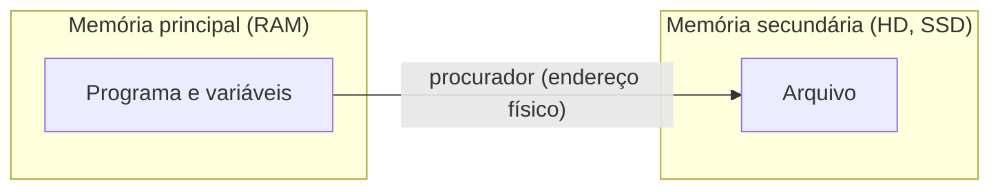

# Notas de aula: Algoritmos e Programação B

Resumo do que foi visto em cada aula, com links para os programas feitos a partir de cada conteúdo. Os programas ficam na pasta [programas](programas).

Professor: Alexandre Zamberlan · [repositório da disciplina](https://github.com/alexandrezamberlan/algoritmos)

## Roteiro da disciplina

- [x] Structs
- [x] Modularização com métodos
- [x] Arquivos texto
- [ ] Ponteiros e alocação dinâmica de memória

## Sumário

| Data | Assunto |
|---|---|
| 27/07 | Apresentação da disciplina e revisão de Algoritmos A |
| 03/08 | Menu e vetores em C e C++ |
| 10/08 | `vector` e introdução a `struct` |
| 17/08 | Lista de exercícios de `struct` |
| 24/08 | Leitura de arquivos |
| 31/08 | Primeira avaliação |
| 14/09 | Arquivos: memória, escrita e append |
| 21/09 | IA generativa e stop words |
| 28/09 | Modularização: procedimentos e funções |
| 14/10 | Métodos (continuação) |

---

## 27/07: Apresentação da disciplina

- Como a disciplina funciona: notas de aula e entregas pelo GitHub
- Conteúdo do semestre: structs, modularização com métodos, arquivos texto e ponteiros
- Revisão de Algoritmos A:
  - estrutura de um programa
  - instruções primitivas e de controle
  - variáveis
  - lógica
- Princípio **KISS** (*Keep It Simple, Stupid*): a solução mais simples que resolve o problema costuma ser a melhor
- Exercícios de revisão sobre sono e doses de insulina

## 03/08: Menu e vetores em C e C++

- Programa com menu de opções, feito em C e em C++
- Vetor com n elementos sorteados com `rand()`
- Lista de exercícios

Estrutura básica de um menu: o `do-while` repete até o usuário escolher sair, e o `switch` executa a opção escolhida.

```cpp
int opcao;
do {
    cout << "1 - Popular vetor\n";
    cout << "0 - Sair\n";
    cin >> opcao;

    switch (opcao) {
        case 1:
            // ...
            break;
        case 0:
            cout << "Saindo...\n";
            break;
        default:
            cout << "Opcao invalida\n";
    }
} while (opcao != 0);
```

| | C | C++ |
|---|---|---|
| Biblioteca de entrada e saída | `#include <stdio.h>` | `#include <iostream>` |
| Mostrar na tela | `printf("%d", x);` | `cout << x;` |
| Ler do teclado | `scanf("%d", &x);` | `cin >> x;` |

**Programas:**
- [menu_operacoes_vetor.c](programas/menu_operacoes_vetor.c) e [menu_operacoes_vetor.cpp](programas/menu_operacoes_vetor.cpp): menu que sorteia, ordena (bubble sort) e calcula média, mediana, maior e menor
- [ler_e_exibir_vetor.c](programas/ler_e_exibir_vetor.c): leitura e exibição de um vetor em C

## 10/08: `vector` e introdução a `struct`

- Revisão de vetores com `vector` e `push_back`
- Como os elementos são alocados no vetor
- Introdução a `struct`: um tipo próprio que agrupa vários dados sobre a mesma coisa
- Atividade: Garagem em C++

```cpp
struct Veiculo {
    string placa;
    string cor;
    string horaEntrada;
};

vector<Veiculo> garagem;
garagem.push_back({"ABC1234", "Preto", "08:00"});  // adiciona no final do vetor
```

**Programas:**
- [estacionamento_cobranca.cpp](programas/estacionamento_cobranca.cpp): a atividade da garagem, com cálculo do valor a pagar pelo tempo de permanência

## 17/08: Lista de exercícios de `struct`

- Continuação de `struct`
- Lista com 10 exercícios: cadastros com menu, guardando os registros em um `vector` de `struct`

**Programas:**
- [academia_aluno_mais_alto.cpp](programas/academia_aluno_mais_alto.cpp)
- [banco_contas_e_depositos.cpp](programas/banco_contas_e_depositos.cpp)
- [biblioteca_livros_apos_2020.cpp](programas/biblioteca_livros_apos_2020.cpp)
- [concessionaria_busca_por_preco.cpp](programas/concessionaria_busca_por_preco.cpp)
- [consumo_energia_media_rua.cpp](programas/consumo_energia_media_rua.cpp)
- [esports_busca_jogador.cpp](programas/esports_busca_jogador.cpp)
- [loja_cadastro_clientes.cpp](programas/loja_cadastro_clientes.cpp)
- [media_notas_alunos.cpp](programas/media_notas_alunos.cpp)
- [minimercado_valor_estoque.cpp](programas/minimercado_valor_estoque.cpp)
- [rh_filtro_funcionarios.cpp](programas/rh_filtro_funcionarios.cpp)

## 24/08: Leitura de arquivos

- Ler um arquivo de texto de outro local para usar os dados no programa, com `#include <fstream>` e `ifstream`

```cpp
ifstream arquivo("dados.txt");
if (!arquivo) {
    cout << "Arquivo nao encontrado\n";
}
string linha;
while (getline(arquivo, linha)) {  // le uma linha por vez
    cout << linha << endl;
}
arquivo.close();
```

**Programas:**
- [exibir_arquivo_texto.cpp](programas/exibir_arquivo_texto.cpp): abre o arquivo informado pelo usuário e mostra o conteúdo

## 31/08: Primeira avaliação

- 2 exercícios de `struct`
- 1 programa de biblioteca

## 14/09: Arquivos: memória, escrita e append

- Arquivos permitem a troca de dados entre sistemas (texto, CSV, JSON ou um banco de dados)
- As variáveis ficam na memória principal (RAM) e se perdem quando o programa termina. Os arquivos ficam na memória secundária (HD, SSD) e continuam lá.
- O programa acessa o arquivo por um **procurador**, que guarda o endereço físico do arquivo e funciona como um ponteiro:
  - procurador leitor: `ifstream`
  - procurador escritor: `ofstream`
- Formas de escrever:
  - **write**: cria o arquivo do zero e apaga o que havia antes
  - **append**: adiciona no final, mantendo o conteúdo
- Correção da prova



```cpp
ofstream novo("nomes.txt");                      // write: cria do zero
ofstream base("base.dat", ios::out | ios::app);  // append: escreve no final
```

**Programas:**
- [gravar_nomes_em_arquivo.cpp](programas/gravar_nomes_em_arquivo.cpp): write, e não sobrescreve um arquivo que já existe
- [cadastro_nomes_persistente.cpp](programas/cadastro_nomes_persistente.cpp): append, carregando os nomes salvos ao abrir o programa

## 21/09: IA generativa e stop words

- IA generativa
- Programa que lê uma lista de stop words de um arquivo e grava o texto sem elas em outro arquivo
- Stop words são palavras muito comuns (artigos, preposições, pronomes) que costumam ser removidas antes de analisar um texto, porque aparecem em todo lugar e quase não carregam significado

**Programas:**
- [remover_stop_words](programas/remover_stop_words): lê `stop_words.txt` e `texto_original.txt` e grava `texto_sem_stop_words.txt`

## 28/09: Modularização: procedimentos e funções

Revisão do que já foi visto:
- `struct` combinada com vetores
- Arquivos de texto puro (CSV, XML, JSON, TOON)

**Modularização** é dividir o programa em métodos, em vez de escrever todas as funcionalidades uma abaixo da outra (programação sequencial, no estilo script). Essa divisão é chamada de **decomposição funcional** e traz:
- **reuso**: o mesmo método serve para várias partes do programa, ou para outros programas
- **manutenção mais fácil**: para corrigir algo, você mexe em um lugar só

| | Procedimento | Função |
|---|---|---|
| Retorno | não tem: usa `void` | tem: usa `return` |
| Como aparece no código | `metodo();` ou `metodo(3, x);` | `var = metodo(3, x);` ou `if (metodo(3, x) == true)` |
| Exemplo nos programas | `exibirVetor(v);` | `bool achou = contem(v, 10);` |

```cpp
// procedimento: faz algo e não devolve nada
void nomeProcedimento(tipo param1, tipo param2) {
    // codigos
}

// função: calcula e devolve um valor do tipo declarado
tipo nomeFuncao(tipo param1, tipo param2) {
    // codigos
    return valor_daquele_tipo;
}
```

Conceitos:
- **Parâmetro** (ou argumento): valor que o método recebe para trabalhar
- **Operação**: o que se quer que o programa faça
- **Método**: uma forma específica de resolver aquela operação

Exemplo de reuso: [meusMetodos.h](programas/meusMetodos.h) reúne métodos usados por dois programas diferentes, que só precisam fazer `#include "meusMetodos.h"`.

## 14/10: Métodos (continuação)

- Revisão: procedimentos são métodos sem retorno (`void`), e funções são métodos com retorno (`return`)

**Programas:**
- [vetores_elementos_em_comum.cpp](programas/vetores_elementos_em_comum.cpp): procedimentos e funções com vetores, comparando passagem por valor e por referência
- [extrair_sobrenome.cpp](programas/extrair_sobrenome.cpp): função que separa o sobrenome do nome completo
- [ler_e_exibir_nomes.cpp](programas/ler_e_exibir_nomes.cpp): leitura de nomes completos com `getline`

---

## Complemento: passagem por valor e por referência

| | Por valor | Por referência |
|---|---|---|
| Como declarar | `void exibir(vector<int> v)` | `void popular(vector<int> &v)` |
| O que o método recebe | uma cópia | o próprio dado original |
| Alterações dentro do método | não afetam quem chamou | ficam valendo depois que o método termina |
| Quando usar | só para ler os dados | para preencher ou modificar os dados |

```cpp
// por referência (&): o vetor do main é preenchido
void popularVetor(vector<int> &v, int qtd) {
    for (int i = 0; i < qtd; i++) {
        v.push_back(rand() % 20 + 1);
    }
}

// por valor: recebe uma cópia, só lê
void exibirVetor(vector<int> v) {
    for (int i = 0; i < v.size(); i++) {
        cout << v[i] << " ";
    }
}
```
